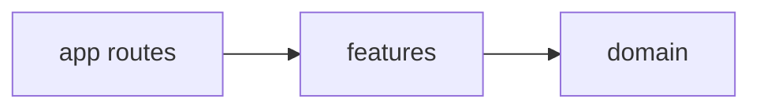

# Indie catalog

How AI tools were used: see [AI_WORKFLOW.md](AI_WORKFLOW.md).

Internal dashboard for a fictional indie-game catalog, plus a streaming chat that answers questions by calling tools. The catalog is never pasted into the model prompt.

## How to run

Requires Node.js 20 (this repo pins AI SDK 6 because AI SDK 7 needs Node 22+).

```bash
npm install
cp .env.example .env.local
# set GEMINI_API_KEY (and optionally GEMINI_MODEL) in .env.local
npm run dev
```

Open [http://localhost:3000](http://localhost:3000) for the dashboard and [http://localhost:3000/chat](http://localhost:3000/chat) for chat.

Without `GEMINI_API_KEY`, the dashboard still works. The chat page tells you to set the key, and `POST /api/chat` returns `503`.

```bash
npm run lint
npm run typecheck
npm test
npm run build
```

## API

| Method | Path | Success | Errors |
| --- | --- | --- | --- |
| GET | `/api/games` | `200` array of games | `500` if the catalog database is corrupt |
| POST | `/api/games` | `201` created game | `400` `{ error, fields }`, `409` duplicate title, `413` body over 10 KB, `500` unexpected |
| GET | `/api/games/:id` | `200` game | `404`, `500` unexpected |
| PUT | `/api/games/:id` | `200` updated game | `400` field errors, `404` missing, `409` duplicate title, `413` body over 10 KB, `500` unexpected |
| DELETE | `/api/games/:id` | `204` | `404`, `500` unexpected |
| POST | `/api/chat` | UI message stream | `503` if `GEMINI_API_KEY` is missing, `400` for a bad body, `413` body over 64 KB, `429` with `Retry-After` after 20 requests per minute per IP |

Game fields: `id`, `title`, `developer`, `genre`, `monthly_revenue_usd` (int ≥ 0), `monthly_downloads` (int ≥ 0), `average_rating` (0–5, one decimal).

## Tools

The model can call:

1. `search_games` — optional `genre`, `developer`, `rating_above` (strict `>`), `rating_at_least` (`>=`), `sort_by`, `order`, `limit` (default 10, max 20). Sorting revenue descending keeps every game tied for the top revenue.
2. `count_games` — the same filters.
3. `compare_games` — `{ titles: string[2..4] }`. Exact title match, case-insensitive. Returns rows plus absolute and percent difference versus the first title. Missing titles return `{ notFound, suggestions }` and no invented rows. A suggestion is a catalog title that contains the typed text. Differences are rounded to 6 decimal places. Percent is `null` when the baseline is 0.
4. `aggregate_games` — `{ metric, op: sum|avg|min|max, group_by?: genre|developer }`. `avg` is rounded to 2 decimal places in code. Sum, min, and max are not rounded.

All math runs in code. Tool results are capped at 20 rows. The chat loop stops after 5 steps. The server keeps the last 12 messages and drops a leading non-user message so the window starts with the user.

## Architecture

```
src/app                          routes and route handlers only
src/features/games/domain        types, input schema, title rules, catalog queries
src/features/games/server        SQLite repository
src/features/games/components    dashboard, table, dialogs
src/features/chat/server         tool wrappers, prompt, trim, rate limit, model
src/features/chat/components     chat panel
src/lib                          shared helpers (HTTP errors)
src/components                   shared chrome (site header)
```

1. `features/*/domain` imports nothing from `react`, `next`, `fs`, or `ai`.
2. Components never import from a `server` folder.
3. There is no barrel `index.ts` that mixes components and server code.



Feature folders keep each product area's domain, server code, and UI together, instead of splitting one feature across layer folders or atomic design.

## Design decisions

- Persistence is a SQLite file, `data/games.sqlite` by default, behind `src/features/games/server/repository.ts`. The first time that file is created, rows are copied from `data/games.json`. `GAMES_DATA_FILE` points at a different database. Delete the database file to load the seed again.
- Routes and pages that read the file or `process.env` set `dynamic = "force-dynamic"` so a POST is visible on the next GET.
- Gemini is called with `@ai-sdk/google` `createGoogleGenerativeAI({ apiKey: process.env.GEMINI_API_KEY })` because the provider’s default env var is `GOOGLE_GENERATIVE_AI_API_KEY`. Default model is `gemini-2.5-flash`.
- AI SDK 6 APIs from the installed docs: `streamText`, `tool({ inputSchema })`, `stopWhen: stepCountIs(5)`, `convertToModelMessages`, `result.toUIMessageStreamResponse()`, and `useChat` with `DefaultChatTransport`.

## Beyond the brief

- Every route uses `apiError`. Unexpected failures return `500` `{ error: "Something went wrong" }`. The real error is logged on the server and is not sent to the client.
- Games `POST`/`PUT` reject a `Content-Length` over 10 KB with `413`. Chat rejects a `Content-Length` over 64 KB with `413`.
- A missing database is created empty, then seeded from `data/games.json` when that file is present. A database that is not SQLite logs a clear server error and the request returns `500`. It does not retry in a loop.
- Chat checks that `messages` is an array of objects with a role of `system`, `user`, or `assistant` and a `parts` array. Each user text part is capped at 1000 characters. The model call uses `AbortSignal.timeout(30_000)`.
- Chat rate limit: 20 requests per minute per IP, `429` plus `Retry-After`. It is demo-grade and per process. A restart clears it, and another instance does not share the counts.
- Tests use `GAMES_DATA_FILE` so they write a temp SQLite file and never the real database or `data/games.json`. They cover repository CRUD, duplicate titles, 60 parallel creates, the route status codes above, the limiter with an injected clock, and one streamed `search_games` call through `MockLanguageModelV3`.

## Going to production

The catalog is a local SQLite file. A serverless filesystem is still read-only, so production needs that file on a volume or a move to Postgres. Add auth. Move the rate limit to a shared store. Add observability. Keep `GEMINI_API_KEY` on the server. Auth and deployment were left out on purpose.

## Limitations

- SQLite serializes writes to the database file. The chat rate limit is still in-process only, so another instance does not share it.
- The catalog has one monthly figure per game, not a month history.
- Chat needs a Gemini key and is subject to provider quota (the UI shows the `useChat` error, including 429/quota).
- Chat history is not persisted when navigating away.
